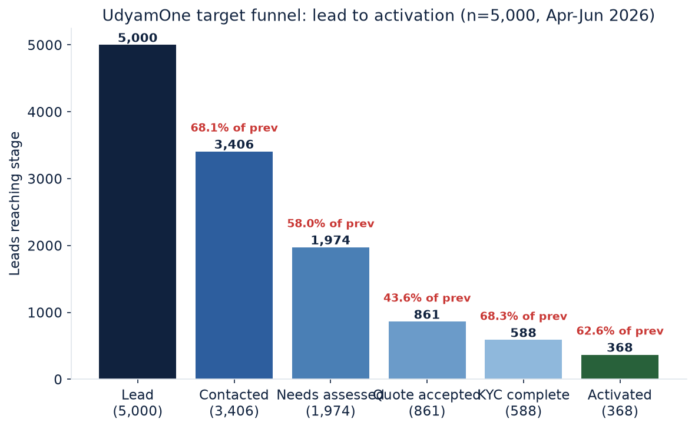
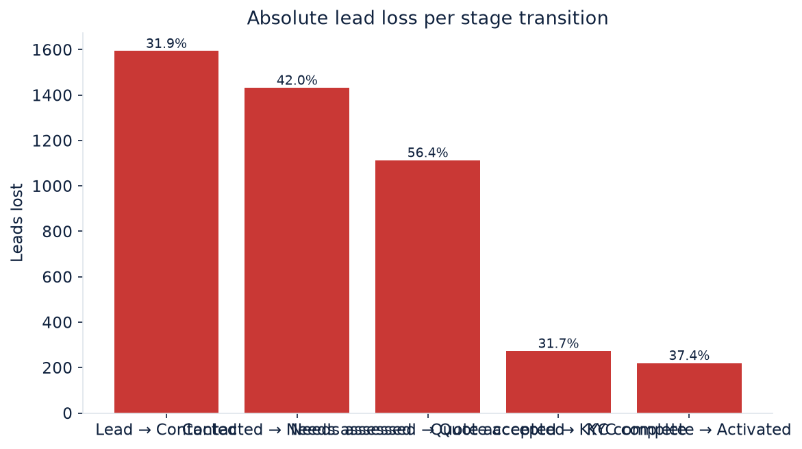
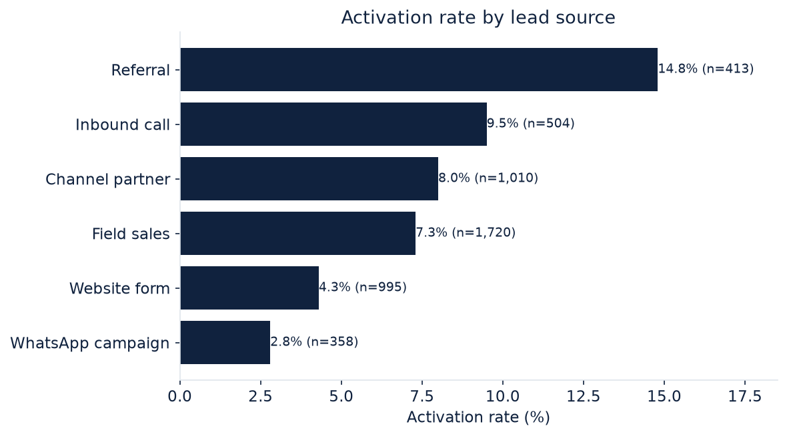
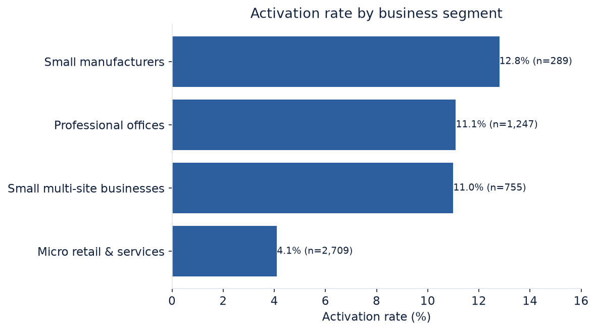
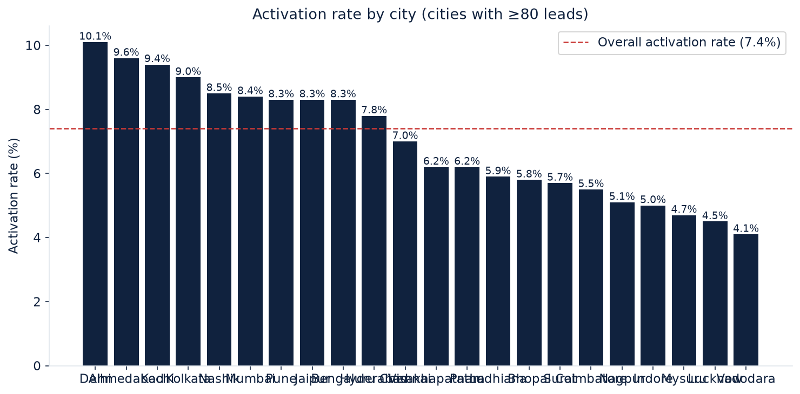
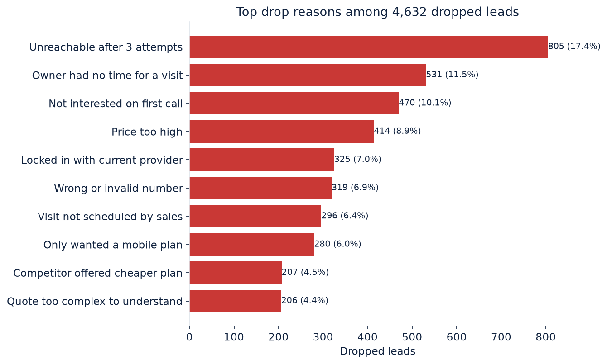
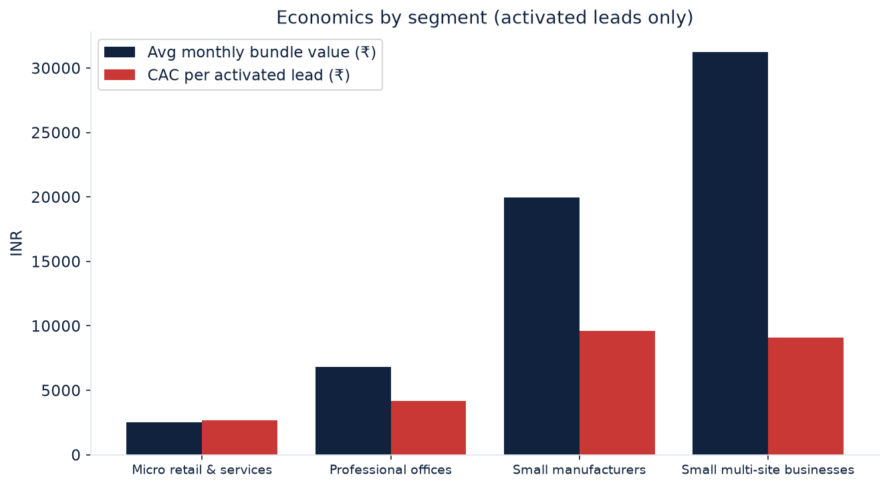
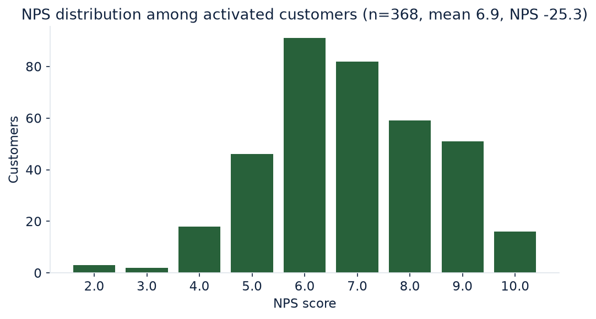

# UdyamOne — Business Impact Analysis (SMB Leads, Apr–Jun 2026)

**Dataset**: `data/sample_leads/smb_leads.csv` — 5,000 synthetic SMB leads  
**Analysis script**: `scripts/analyze_leads.py` (fully reproducible; aggregates only, no individual identifiers)  
**Outputs**: `docs/business_analysis/` (summary CSVs + PNG charts + `summary.json`)  
**Status**: All figures below are computed from the dataset. Prototype capability improvements are **projections, not measured results**.

---

## Executive Summary

Analysis of 5,000 synthetic SMB leads (April–June 2026) confirms the onboarding journey loses **92.6% of all leads before activation** (368 of 5,000 activate). The funnel's three largest leaks are all **front-office friction points UdyamOne directly addresses**:

1. **Quote → Accepted is the worst-performing transition: only 43.6% of businesses that received a quote accepted it.** Price confusion ("Price too high", "Quote too complex to understand", "Quote took too long to arrive") accounts for a large share of losses. UdyamOne's instant, itemized quote preview with transparent estimated pricing attacks exactly this.
2. **1,594 leads (31.9%) are never successfully contacted**, with "Unreachable after 3 attempts" (805 leads, 17.4% of all drop reasons) and "Wrong or invalid number" (319) topping the list — a channel-quality problem at the top of the funnel.
3. **Post-quote KYC drop (273 leads, 31.7% of quote-accepters)** is dominated by document friction ("Missing GST or Udyam document", "Found paperwork too long", "Document details did not match") — precisely the workflow UdyamOne's Smart KYC with local OCR and guided corrections streamlines.


Activated customers represent **₹4.54M monthly recurring bundle value** and **₹5.11M estimated one-time setup value**. **Blended CAC is ₹15,053 per activated customer** (₹5,539,640 total funnel spend ÷ 368 activations — matching the case-pack's "approximately ₹15,000"); the direct cost recorded on converted leads alone is ₹5,385 (see `docs/BUSINESS_METRIC_RECONCILIATION.md`). Of the ₹5,539,640 total acquisition spend, ₹3,557,890 (64.2%) is associated with leads that dropped before activation. NPS among activated customers is **-25.3** (43.5% detractors) — consistent with a frustrating, opaque process that UdyamOne's tracking and transparency are designed to fix.


**Segment insight**: Micro retail is the largest segment (2,709 leads) but converts at only **4.1%**, while Small multi-site businesses (755 leads, 11.0%) and Small manufacturers (289 leads, 12.8%) convert 2.5–3× better and carry 5–12× the average monthly value. **Referral is the best channel (14.8% activation, ₹605 avg CAC); WhatsApp campaigns are the worst (2.8%).**

---

## 1. Methodology

- **Tooling**: Python 3.11 + pandas 2.x; single script `scripts/analyze_leads.py`; charts via matplotlib (Agg backend).
- **Reproduce**: `.\.venv\Scripts\python.exe scripts\analyze_leads.py` from the repository root. All outputs regenerate deterministically.
- **Funnel denominators**: `stage_reached` records the *last* stage a lead reached. Because the funnel is strictly ordered, "reached stage N" is computed as `stage_reached ∈ {N, ..., Activated}` (cumulative). E.g. Quote-accepted = leads with `stage_reached ∈ {Quote accepted, KYC complete, Activated}` = 861. Conversion at each transition uses the *previous stage's cumulative reach* as denominator; drop-off is the absolute difference.
- **Cohort discipline**: Revenue, CAC, churn and NPS are computed **only over the 368 activated leads** (the cohort for which those fields are populated). "CAC per total lead" is reported separately and labelled.
- **Small samples**: Segment/channel tables report `n` alongside every rate. Conclusions are drawn only where the cohort is large enough for the difference to be meaningful; city-level analysis is restricted to cities with ≥80 leads in the chart and flagged in text otherwise.
- **Privacy**: No individual names, GSTINs, Udyam numbers or contact details are printed or exported. Only aggregated tables and distributions are written to `docs/business_analysis/`.
- **Limitations** (see §7 for the full list): synthetic competition data; `drop_reason` is only recorded for dropped leads; quote values are estimates, not billing data.

---

## 2. Funnel Analysis

| Stage | Leads reached | Conversion from previous | Drop-off (leads) | Drop-off % of previous |
|---|---:|---:|---:|---:|
| Lead | 5,000 | — | — | — |
| Contacted | 3,406 | 68.1% | 1,594 | 31.9% |
| Needs assessed | 1,974 | 58.0% | 1,432 | 42.0% |
| **Quote accepted** | **861** | **43.6%** | **1,113** | **56.4%** |
| KYC complete | 588 | 68.3% | 273 | 31.7% |
| Activated | 368 | 62.6% | 220 | 37.4% |

- **Lead → Activation overall conversion: 7.4%** (368 / 5,000).
- **Largest proportional bottleneck: Quote → Accepted (56.4% drop-off, 1,113 leads lost).**
- Largest *absolute* leak is Contact stage (1,594 leads never contacted), but a large share of that is data-quality/channel ("Unreachable", "Wrong number") rather than a product-experience failure — UdyamOne can't fix a wrong phone number, but a web self-serve entry path sidesteps parts of it.
- Stage-share of all 4,632 dropped leads: Contact 34.4%, Needs-assessed 30.9%, Quote 24.0%, KYC 5.9%, Fulfilment 4.7%.




---

## 3. Segment & Channel Analysis

### By lead source (all leads, n ≥ 30 per row)

| Lead source | Leads | Activated | Activation rate | Avg monthly value (₹) | Avg acquisition cost (₹) |
|---|---:|---:|---:|---:|---:|
| Referral | 413 | 61 | **14.8%** | 11,077 | 605 |
| Inbound call | 504 | 48 | 9.5% | 12,509 | 487 |
| Channel partner | 1,010 | 81 | 8.0% | 10,359 | 1,672 |
| Field sales | 1,720 | 125 | 7.3% | 12,966 | 1,769 |
| Website form | 995 | 43 | 4.3% | 14,834 | 274 |
| WhatsApp campaign | 358 | 10 | **2.8%** | 17,121 | 112 |

**Read**: Referral leads convert 2× the blended rate (7.4%) at the lowest CAC. Website-form leads are cheap (₹274 avg cost) but convert poorly — a strong candidate for UdyamOne's guided digital onboarding to raise quality before sales contact. WhatsApp has the *highest* average bundle value among activated leads (₹17,121) but only 10 activations — the channel delivers high-value businesses that the current manual process fails to close.



### By business segment

| Segment | Leads | Activated | Activation rate | Avg monthly value (₹) |
|---|---:|---:|---:|---:|
| Small manufacturers | 289 | 37 | **12.8%** | 19,980 |
| Professional offices | 1,247 | 138 | 11.1% | 6,796 |
| Small multi-site businesses | 755 | 83 | 11.0% | **31,233** |
| Micro retail & services | 2,709 | 110 | **4.1%** | 2,505 |

**Read**: Micro retail is half the lead volume but the worst converter and lowest value. Multi-site businesses are the revenue engine: 15.1% of leads, but ₹2.59M of the ₹4.54M total monthly value (**57%**). Manufacturers combine high conversion with high value.



### By city tier, language, size

- **Tier 1 cities convert meaningfully better than Tier 2** (`by_city_tier.csv`).
- **Employee count and site count correlate positively with activation** (`by_employee_band.csv`, `by_sites_band.csv`): 51+ employee and 4+ site businesses convert several times better than 1–5 employee / single-site businesses.
- Language mix broadly mirrors population; no language shows an anomaly once sample size is considered.
- **City spread** (cities ≥80 leads): Delhi (10.1%), Ahmedabad (9.6%), Kochi (9.4%) lead; Vadodara (4.1%), Lucknow (4.5%) and Mysuru (4.7%) lag. The spread (~2.5×) suggests execution capacity differences by circle, worth flagging but not over-interpreting.



---

## 4. Drop-Off & Recovery Opportunities

### Top drop reasons (of 4,632 dropped leads)

| Drop reason | Count | % of dropped |
|---|---:|---:|
| Unreachable after 3 attempts | 805 | 17.4% |
| Owner had no time for a visit | 531 | 11.5% |
| Not interested on first call | 470 | 10.1% |
| Price too high | 414 | 8.9% |
| Locked in with current provider | 325 | 7.0% |
| Wrong or invalid number | 319 | 6.9% |
| Visit not scheduled by sales | 296 | 6.4% |
| Only wanted a mobile plan | 280 | 6.0% |
| Competitor offered cheaper plan | 207 | 4.5% |
| **Quote too complex to understand** | **206** | **4.4%** |
| **Quote took too long to arrive** | **179** | **3.9%** |
| Missing GST or Udyam document | 94 | 2.0% |
| Found paperwork too long | 79 | 1.7% |
| Document details did not match | 47 | 1.0% |



### Recovery prioritisation (evidence-bounded)

- **Quote-stage friction is the largest *addressable* product gap**: "Price too high" (414) + "Quote too complex" (206) + "Quote too slow" (179) + "Competitor cheaper" (207) ≈ **1,006 leads** whose objections are about *transparency, speed and comprehension* — not disinterest. UdyamOne's instant itemised quote directly targets this. (Caveat: we cannot know how many would convert with a better quote; this is an opportunity size, not a forecast.)
- **KYC/paperwork friction** ("Missing GST or Udyam document" 94 + "Paperwork too long" 79 + "Details did not match" 47 + "Signatory unavailable" 53 ≈ **273 leads**) maps 1:1 to Smart KYC's guided upload, OCR extraction, and correction workflow. Notably, "Document details did not match" is exactly what registry verification surfaces automatically.
- **Contact-stage losses** (2,424 leads) are dominated by reachability — a CRM/data-hygiene problem, only partially addressable by a self-serve digital front door.
- **Follow-up calls**: Activated customers averaged **3.0 calls** (median 3, max 5); leads that dropped before quote-acceptance averaged ~1.0. Leads that reached quote/KYC stages and still dropped also averaged ~3 calls. Interpretation: sustained follow-up is associated with reaching late stages, but dropped late-stage customers receiving 3 calls still didn't convert — indicating *quality-of-engagement*, not call volume, is the constraint. This is association, not causation.

---

## 5. Revenue & Unit Economics (activated cohort, n=368)

| Metric | Value | Notes |
|---|---:|---|
| Total monthly bundle value | **₹4,544,990** | Sum of `monthly_bundle_value_inr` for activated leads |
| Average monthly bundle value | ₹12,351 | Median ₹6,900 — right-skewed by multi-site/manufacturing |
| Total estimated one-time setup value | **₹5,107,500** | Estimated one-time value, not billed revenue |
| Total acquisition cost (activated cohort) | ₹1,981,750 | Spend attributed to activated leads |
| **CAC — per activated lead** | **₹5,385** | ₹1.98M ÷ 368 activated (direct CAC; spend recorded on converted leads only) |
| CAC — per total lead (stricter) | ₹1,108 | All-cohort spend ÷ 5,000 leads |
| **Blended CAC (case-pack basis)** | **₹15,053** | ALL-funnel spend (₹5,539,640 incl. dropped-lead spend) ÷ 368 activations — reconciles with the case-pack's "approximately ₹15,000" (see docs/BUSINESS_METRIC_RECONCILIATION.md) |
| Churn within 6 months | **15.2%** (56 of 368) | Post-activation attrition |
| NPS | mean 6.86; **net -25.3** | 18.2% promoters (9–10), 43.5% detractors (0–6) |

### Revenue & CAC by segment (activated only)

| Segment | Activated | Monthly value sum (₹) | Avg monthly (₹) | CAC per activated (₹) | Churned |
|---|---:|---:|---:|---:|---:|
| Small multi-site | 83 | 2,592,380 | 31,233 | 9,099 | 9 |
| Small manufacturers | 37 | 739,250 | 19,980 | 9,606 | 3 |
| Professional offices | 138 | 937,830 | 6,796 | 4,169 | 19 |
| Micro retail | 110 | 275,530 | 2,505 | 2,688 | 25 |

**Read**: Multi-site and manufacturing CAC is 2–4× higher, but their monthly value is 5–12× higher — the value-per-CAC ratio strongly favours focusing the consultative (advisory-driven) journey on these segments, while micro retail needs a cheaper, self-serve-oriented flow. Micro retail also churns most in absolute terms (25 of 56 churned).




---

## 6. UdyamOne Business Impact Mapping

Every mapping below follows the required structure. **All "expected benefit" statements are projections based on the funnel data — the prototype has not measured any of these outcomes.**

### 6.1 AI Business Advisor + Product Recommendations
- **Problem**: 1,113 leads dropped at quote stage; 470 "not interested on first call" and 531 "no time for a visit" reflect engagements that never understood the customer's actual need.
- **Capability**: Multilingual AI advisor (`backend/app/services/advisor_service.py`) extracts requirements conversationally in 5 languages; recommendation engine maps them to catalog bundles.
- **Expected benefit (projected)**: Better-qualified demand reaching the quote stage; fewer "not interested" dead-ends.
- **KPI**: Quote-acceptance rate on advisor-originated quotes (baseline in this dataset: 43.6%).
- **Scenario assumptions** (clearly labelled, not measured):
  - *Conservative*: +3 pp quote acceptance (43.6% → 46.6%)
  - *Moderate*: +8 pp (→ 51.6%)
  - *Ambitious*: +15 pp (→ 58.6%)

### 6.2 Instant Transparent Quote (Pricing & Eligibility Engine)
- **Problem**: "Quote took too long to arrive" (179), "Quote too complex to understand" (206), "Price too high" (414).
- **Capability**: Catalog-backed pricing service produces an itemised, instant quote preview with explicit ranges.
- **Expected benefit (projected)**: Faster quote turnaround and higher comprehension → fewer quote-stage losses.
- **KPI**: Quote turnaround time; quote-stage drop-off (baseline: 56.4%).
- **Scenarios**: quote-stage drop-off −5 pp (conservative) / −10 pp (moderate) / −18 pp (ambitious).

### 6.3 Smart KYC (Local OCR + Guided Corrections)
- **Problem**: ~273 quote-accepted leads lost to KYC friction ("Missing GST or Udyam document", "Paperwork too long", "Signatory unavailable", "Details did not match").
- **Capability**: Consent-gated uploads, local OCR extraction, guided field correction with full audit trail, reviewer workflow.
- **Expected benefit (projected)**: Fewer KYC abandonments; lower reviewer rework.
- **KPI**: KYC-completion rate among quote-accepters (baseline: 68.3%); average corrections per document.
- **Scenarios**: KYC completion +4 pp / +9 pp / +15 pp (68.3% → 72.3% / 77.3% / 83.3%).

### 6.4 Synthetic GSTIN/Udyam Verification
- **Problem**: 47 leads dropped for "Document details did not match"; verification currently happens late and manually, with disputes surfacing after weeks.
- **Capability**: Automated registry comparison at KYC time (`POST /verify-registries`) with structured VERIFIED/MISMATCH/UNAVAILABLE/INCONCLUSIVE outcomes.
- **Expected benefit (projected)**: Early mismatch detection prevents late-stage failures; verified businesses proceed to order with confidence.
- **KPI**: % of KYC completions with a verification decision recorded before order placement.
- **Important**: In production this requires live GSTN/Udyam APIs — the prototype uses synthetic competition datasets.

### 6.5 Customer Order Tracking
- **Problem**: Activated customers made a median of **3 follow-up calls**; late-stage drop reasons include "Installation delayed beyond 21 days" (98) and "Customer cancelled before install" (53).
- **Capability**: Order timeline with per-stage events, actor attribution, and status visibility.
- **Expected benefit (projected)**: Reduced inbound status calls and early visibility of delays. **UdyamOne provides visibility and accountability; the dataset does not establish that it shortens physical installation time.**
- **KPI**: Follow-up calls per activated customer (baseline: 3.0 mean / 3.0 median); cancellations before install.
- **Scenarios**: calls per customer −0.5 / −1.0 / −1.5 (proposed, not measured).

### 6.6 Operations & Partner Workflow
- **Problem**: "Visit not scheduled by sales" (296) and post-acceptance drop (273) indicate hand-off and scheduling gaps; partner accountability is invisible in the current process.
- **Capability**: Operations dashboard (assign/reassign with reasons), partner workspace with progress notes, append-only audit trail, ON_HOLD with resumption.
- **Expected benefit (projected)**: Fewer unscheduled visits, faster partner response, auditable hand-offs.
- **KPI**: Time from order to partner assignment; % of orders with partner note updates within SLA.

### 6.7 Consolidated scenario table (illustrative, assumptions stated)

Illustrative annualised recurring value uplift if the moderate scenario held (assumption, not measurement): recovering a fraction of the 1,113 quote-stage losses at the segment-mix average monthly value of ₹12,351. At +8 pp quote acceptance on the ~4,366 leads reaching needs-assessment annually-equivalent volume, this is ≈ +349 accepted quotes; at the observed 68.3% KYC and 62.6% activation conversion, ≈ +149 activations ≈ **₹1.84M incremental monthly recurring value (moderate scenario, assumption-based)**. Conservative and ambitious scenarios scale this proportionally (≈ ₹0.69M / ₹3.45M). These are **modelling exercises to size the opportunity**, not forecasts of achieved results.

---

## 7. Limitations & Data Caveats

1. **Synthetic data**: All figures derive from the supplied competition dataset; real-world validation is required before treating them as market facts.
2. **Funnel cohort**: `stage_reached` + `outcome` are consistent (activated ⇒ stage Activated; dropped ⇒ stage = last reached), so cumulative reach is reliable; no records were discarded.
3. **Drop reasons exist only for dropped leads**; the 368 activated leads contribute no drop-reason signal.
4. **Revenue fields are estimates** recorded on the lead record, not billed invoices; `monthly_bundle_value_inr` is recurring value and `one_time_setup_inr` is one-time — they are reported separately and never summed.
5. **CAC has two valid denominators**; both are reported and labelled. Spend is attributed per-lead, so "per activated lead" assumes cohort-level attribution, which the dataset's structure supports but a real financial system would confirm.
6. **Follow-up call correlation ≠ causation**; no time-of-day, call-outcome or rep-level fields exist to control for effort quality.
7. **Small-sample caution**: WhatsApp channel (10 activations) and several cities (<100 leads) have rates with wide uncertainty; they are flagged wherever cited.
8. **No individual-level identifiers** are used or exported anywhere in this analysis.

---

## 8. Reproducibility

```powershell
# from repository root
.\.venv\Scripts\python.exe scripts\validate_leads.py   # data-quality report
.\.venv\Scripts\python.exe scripts\analyze_leads.py    # full analysis + charts
```

Outputs land in `docs/business_analysis/`: `funnel.csv`, `drop_by_stage.csv`, `drop_reasons.csv`, `by_lead_source.csv`, `by_segment.csv`, `by_city.csv`, `by_city_tier.csv`, `by_business_type.csv`, `by_language.csv`, `by_employee_band.csv`, `by_sites_band.csv`, `by_current_provider.csv`, `unit_economics.csv`, `economics_by_segment.csv`, `economics_by_lead_source.csv`, `followup_calls_by_outcome.csv`, `followup_calls_by_stage.csv`, `contract_months_distribution.csv`, `01_funnel.png` … `08_nps_distribution.png`, `summary.json`.
