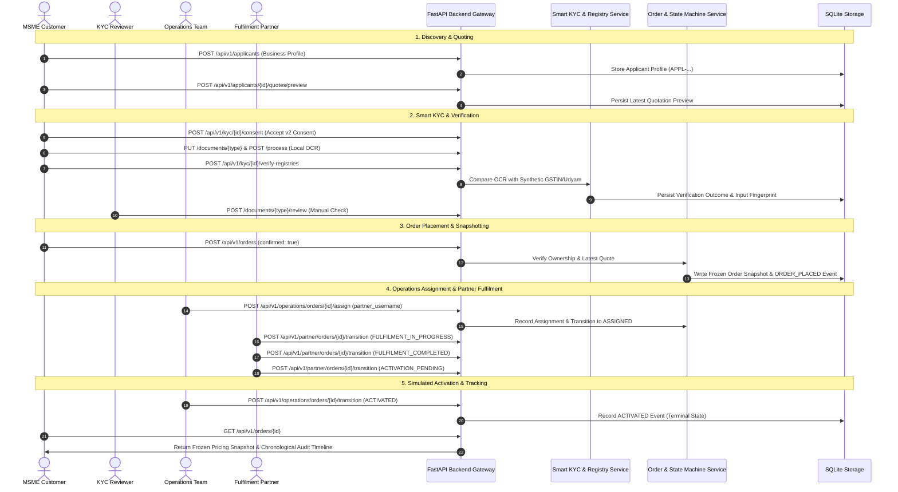

# Technical Architecture & System Design Document

**Product**: UdyamOne  
**Competition**: Airtel SYNC 2026 (Track A: Project Udyam Digital)  
**Team**: PulseForge  
**Architecture Baseline**: Phase 5 Complete  

---

## 1. System Architecture Overview

UdyamOne is designed as an **AI-assisted MSME digital onboarding prototype with an optional external LLM-powered business advisor**. The architecture decouples client interaction from domain enforcement, ensuring data integrity, strict role boundaries, and auditability across the entire customer lifecycle.

**Advisor boundary**: core catalogue recommendations use the existing deterministic recommendation logic; the LLM advisor is optional, is not the authoritative source of catalogue products or pricing, and cannot override catalogue eligibility or the pricing engine. OCR processing remains local — documents and OCR outputs are never sent to the external LLM advisor (the advisor transmits only user-typed chat text and business-profile fields).

```mermaid
graph TD
    subgraph Client Layer [Next.js App Router Frontend]
        Landing[Public Website & Discovery]
        OnboardingUI[Onboarding & Profile /get-started]
        AdvisorUI[AI Business Advisor Chat]
        QuoteUI[Recommendation & Quote Preview]
        KycUI[Smart KYC & Verification /kyc]
        CustomerOrdersUI[Customer Order Tracking /orders]
        OpsUI[Operations Dashboard /operations]
        PartnerUI[Partner Workspace /partner]
    end

    subgraph Security Layer [Security & Role Gateways]
        AuthModule[PBKDF2 Password Verifier & HMAC Session Token Gateway]
        RoleGate[Role-Based Transition & Ownership Enforcement]
    end

    subgraph Application Service Layer [FastAPI Python Services]
        ApplicantService[Applicant Service]
        AdvisorService[Advisor Service & LLM Adapter]
        PricingService[Pricing & Quote Engine]
        RecommendationService[Product Recommendation Engine]
        KycService[Smart KYC & Local OCR Engine]
        RegistryService[Synthetic GSTIN/Udyam Registry Verifier]
        OrderService[Order Persistence & Snapshot Service]
        StateMachine[Order Lifecycle State Machine]
        AssignmentService[Partner Assignment Service]
    end

    subgraph Persistence Layer [Storage & Synthetic Registries]
        SQLiteDB[(SQLite Database: applicants, quotes, orders, events, assignments)]
        UploadStorage[(Local Runtime Document Storage: backend/runtime_uploads)]
        GSTMock[(Mock GSTIN Registry CSV)]
        UdyamMock[(Mock Udyam Registry CSV)]
    end

    %% Client to Security/Gateway
    Landing --> AuthModule
    OnboardingUI --> ApplicantService
    AdvisorUI --> AdvisorService
    QuoteUI --> PricingService
    KycUI --> RoleGate
    CustomerOrdersUI --> RoleGate
    OpsUI --> RoleGate
    PartnerUI --> RoleGate

    RoleGate --> AuthModule
    RoleGate --> OrderService
    RoleGate --> KycService

    %% Service connections
    ApplicantService --> SQLiteDB
    PricingService --> SQLiteDB
    AdvisorService --> RecommendationService
    RecommendationService --> PricingService
    KycService --> UploadStorage
    KycService --> RegistryService
    RegistryService --> GSTMock
    RegistryService --> UdyamMock
    RegistryService --> SQLiteDB

    OrderService --> StateMachine
    OrderService --> AssignmentService
    OrderService --> SQLiteDB
```

---

## 2. End-to-End Operational Lifecycle Sequence

The primary operational flow connects every functional milestone of the UdyamOne platform:

---

## 3. Backend Service Architecture & Layer Separation

### A. HTTP Routing Layer (`backend/app/api/`)
- `applicants.py`: Creation, profile updates, and requirement tracking.
- `advisor.py`: Bounded AI chat interface with localized prompts (`en`, `hi`, `te`, `ta`, `kn`).
- `products.py` & `recommendations.py`: Catalogue inspection and bundle generation.
- `quotes.py`: Authoritative line-item calculation and pricing preview generation.
- `kyc_auth.py`: Session issuance and validation.
- `kyc.py`: Document upload, local OCR processing, field corrections, manual review, and synthetic registry checking.
- `orders.py`: Customer order placement, order listing, order retrieval, and unassigned cancellation.
- `operations.py`: Operational order search, status filtering, partner assignment, and lifecycle transitions.
- `partner.py`: Partner assigned-order inspection and fulfilment progress tracking.

### B. Domain & Persistence Service Layer (`backend/app/services/`)
- **`applicant_service.py`**: Manages applicant identity isolation, stable ID generation (`APPL-...`), and authoritative quote preview persistence.
- **`kyc_service.py`**: Manages uploaded files under `backend/runtime_uploads/`, invokes Windows Media OCR or PyMuPDF, and coordinates manual field corrections.
- **`registry_verification_service.py`**: Executes deterministic string normalization, fuzzy name/city matching, and input fingerprinting against `mock_gstin_registry.csv` and `mock_udyam_registry.csv`.
- **`order_service.py`**: Enforces quote validity, generates frozen snapshots, executes atomic transactions, maintains assignment history (`superseded_at`), and appends application-level append-only events, not tamper-proof records.

---

## 4. Security, Isolation & Role Boundaries

### A. Session Authentication
- Stateless, signed session tokens formatted as `v1.<payload_b64>.<signature_b64>`.
- Signed via HMAC-SHA256 using `UDYAMONE_KYC_AUTH_SECRET`.
- Validated against salted PBKDF2-SHA256 password hashes configured in `UDYAMONE_KYC_AUTH_USERS`.
- Default session lifetime is 1,800 seconds (30 minutes).

### B. Applicant Isolation
- Every applicant record receives a stable identifier (`APPL-...`).
- Customers can access and mutate only applicant profiles explicitly granted in their account configuration (`principal.applicant_ids`).
- Direct URL traversal or guessing of applicant IDs returns HTTP 403 Forbidden.

### C. Partner Isolation
- Partners can view and transition only orders where their username matches the current active assignment (`a.superseded_at IS NULL`).
- Partners cannot access customer KYC documents, unassigned orders, or orders assigned to other partners.
- Partners cannot self-assign or reassign orders.

### D. Operations Isolation
- Only accounts with role `OPERATIONS` can assign partners or trigger final simulated activation.
- Operations users cannot place customer orders or bypass customer consent rules.

---

## 5. Data Privacy & Integrity Principles

1. **Local OCR Extraction**: Document processing is performed strictly on the local backend host (Windows Media OCR / PyMuPDF). Document images, extracted PII, and customer identifiers are never transmitted to external cloud LLM providers.
2. **Auditability of Corrections**: Original OCR-extracted values are preserved alongside user-submitted corrections. Specimen OCR discrepancies are never falsely marked as original clean extractions.
3. **Synthetic Registry Fingerprinting**: The verification table stores one-way input fingerprints, decision metadata, and mismatch field lists rather than duplicating sensitive registry rows.
4. **Frozen Order Snapshots**: The customer's quotation terms are frozen at order creation, ensuring that subsequent catalogue changes or profile edits cannot tamper with historical records.

---

## 6. Production Hardening & Scalability Roadmap

| Prototype Architecture (Current) | Recommended Production Target |
| :--- | :--- |
| **SQLite with Thread Locks** | Managed PostgreSQL with ACID row-level locking (`SELECT ... FOR UPDATE`). |
| **Local File Uploads (`runtime_uploads/`)** | S3-compatible encrypted object storage with presigned URLs and virus scanning. |
| **In-Memory Signed JSON Accounts** | Enterprise Identity Provider (Keycloak / Okta / Azure AD B2C) with OAuth2/OIDC, MFA, and RBAC. |
| **Synthetic CSV Registries** | Direct integration with GSTN APIs and Ministry of MSME Udyam verification portals. |
| **Simulated Activation** | Asynchronous message bus (Kafka/RabbitMQ) connecting to Airtel Enterprise OSS/BSS provisioning systems. |
| **Single-Node FastAPI Runtime** | Containerized Kubernetes deployment with horizontal pod autoscaling and Redis session caching. |
