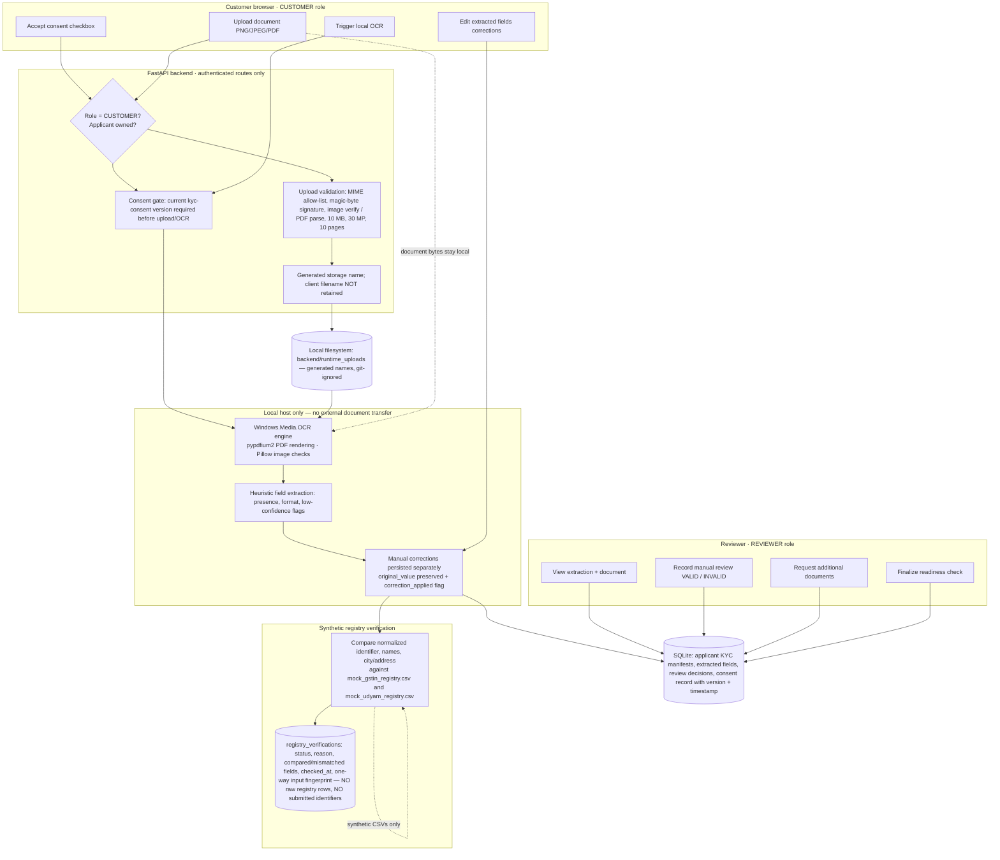

# KYC Data-Flow & Threat Register — Structured Security Artifacts

**Product**: UdyamOne · Airtel SYNC 2026 · Team PulseForge
**Basis**: Read-only inspection of the actual implementation (see `docs/SECURITY_REVIEW.md` for file-and-test references).
**Purpose**: Two structured artifacts required by the Phase 4 task — the KYC data-flow diagram and the threat register. Documentation-only; no code was changed.

---

## 1. KYC Data-Flow Diagram (lifecycle: Consent → Finalisation)

**External-LLM boundary (verified)**: the OCR/extraction path (`kyc_service.py`) invokes only `Windows.Media.OCR` via PowerShell, `pypdfium2` and `Pillow` — all local. The only outbound AI call in the codebase is the **AI Business Advisor** (`advisor` service), which sends *chat text and structured business-profile data the user typed* to the configured OpenAI-compatible endpoint — never document bytes or OCR output. These are two distinct pipelines; the advisor is optional and returns 503 when unconfigured.

---

## 2. Threat Register

Priorities: **P1 = address before any real-user exposure; P2 = production-hardening priority; P3 = accepted prototype risk (documented)**. No intrusive testing was performed; mitigations listed are those verified in code/tests, and residual risks are stated honestly.

| # | Threat | Attack scenario | Existing mitigation (evidence) | Residual risk | Recommended mitigation | Priority |
|---|---|---|---|---|---|---|
| T1 | Unauthorized access to KYC documents | Unauthenticated or cross-applicant retrieval of an uploaded certificate | Every document route requires a valid principal; `require_kyc_read_access` on `GET /{applicant_id}` and `GET /{applicant_id}/documents/{document_type}/file` allows CUSTOMER (own applicant) and REVIEWER only, and rejects OPERATIONS/PARTNER with HTTP 403 (`backend/app/security/kyc_auth.py`, `backend/app/api/kyc.py`); downloads returned with `Cache-Control: no-store`, `nosniff`, sandbox CSP, `no-referrer`; tests: `test_kyc_auth.py`, applicant-isolation tests in `test_orders.py`/`test_kyc.py` | Tokens are stateless (30-min validity after theft); local disk files unencrypted | Server-side revocation/blocklist; encrypted object storage with per-object ACLs in production | P2 |
| T2 | Applicant ID enumeration / cross-applicant access | An unauthenticated caller may use a known or guessed `APPL-…` ID against `PUT /api/v1/applicants/{applicant_id}`, `GET /api/v1/applicants/{applicant_id}`, or `POST /api/v1/applicants/{applicant_id}/quotes/preview`. `POST /api/v1/applicants` creates a new applicant and returns its generated ID. | Applicant IDs are opaque `APPL-` hex values and are not sequential; no search-by-identifier endpoint exists. However, the three ID-based routes have no session, role, or applicant-ownership checks. Knowing an ID may allow reading or replacing pre-KYC profile/recommendation data; the update route also deletes existing quote previews. | Applicant data may be read or modified by anyone who knows an ID; newly created IDs may also be subject to enumeration attempts. | Preserve opaque applicant IDs as defense in depth; protect pre-KYC operations using a server-issued, expiring signed capability bound to the applicant ID; add rate limiting and abuse monitoring. | P1 |
| T3 | Stolen or tampered session tokens | Token exfiltrated from `sessionStorage` (XSS or shared machine) replayed within 30 min | HMAC-SHA256 signature with `hmac.compare_digest`; versioned `v1.` format; expiry + skew checks; malformed/tampered/expired tokens rejected (tests: `test_expired_and_malformed_sessions_are_rejected`, `test_invalid_or_expired_session_token_rejected`) | No server-side revocation; `sessionStorage` is XSS-readable; no MFA | Short TTLs already in place; add server-side revocation list, MFA/SSO, HttpOnly cookie transport in production; XSS review of frontend | P1 (prod), P3 (prototype demo) |
| T4 | Malicious document uploads | Weaponized PDF (parser exploit), polyglot file, decompression bomb disguised as KYC doc | Strict allow-list + magic-byte check; Pillow `verify()` + 30 MP cap; pypdfium parse with 10-page cap and `%%EOF` trailer check; 10 MB streaming cap enforced *during* read (`backend/app/api/kyc.py` `upload_kyc_document`, `kyc_service._validate_upload`) | No antivirus/malware scanning; Pillow/pdfium parser CVEs depend on dependency freshness | Malware scanning (ICAP/ClamAV pipeline), dependency vulnerability monitoring, sandboxed OCR workers | P2 |
| T5 | Exposure of environment secrets | `.env` committed or leaked; `UDYAMONE_KYC_SECRET`/`USERS` in logs or client bundle | `.gitignore` excludes `.env` and runtime uploads; secret only read server-side (`kyc_auth.py`); frontend uses only `NEXT_PUBLIC_API_BASE_URL`; password hashes never returned by API | Secret lives in plaintext env of the dev machine; no rotation mechanism | Managed secrets (vault/KMS), rotation runbook, CI secret-scanning | P2 |
| T6 | Excessive retention of sensitive records | Uploaded KYC documents and extracts retained indefinitely on disk/DB | **No automatic retention or deletion mechanism exists** — documents persist under `backend/runtime_uploads/` and manifests in SQLite until manually removed | Unbounded retention of PII files; contradicts data-minimisation expectations | Implement configurable retention (e.g., propose 90 days post-decision), scheduled purge job, deletion audit records — **proposed, not implemented** | P1 (policy) |
| T7 | Unauthorized partner actions | Partner advances another partner's order, assigns orders, or activates | Partner transitions validate *current active assignment* matches session username; TRANSITION_ROLES bars partners from assignment/activation; partner list endpoint returns only actively-assigned orders; tests: `test_partner_cannot_access_unassigned_order`, `test_partner_cannot_access_another_partners_order`, `test_partner_cannot_reassign_orders`, e2e partner/activation checks | KYC document access is now enforced by `require_kyc_read_access` (`backend/app/security/kyc_auth.py`) which rejects OPERATIONS and PARTNER with 403 on the KYC assessment and document-download routes (`backend/app/api/kyc.py`); partners have no KYC routes | Per-order rate limits; partner-side event anomaly alerts in production | P3 (prototype), P2 (prod monitoring) |
| T8 | Accidental disclosure through logs | OCR text, identifiers or tokens written to logs/stdout | No structured logging of document contents identified in `kyc_service.py` (processing runs return state, not raw dumps); error responses use generic messages without internal tracebacks (FastAPI handlers map exceptions to HTTP codes) | No centralized audit-logging system exists; uvicorn access logs may record URLs containing applicant IDs | Explicit log scrubbing policy, structured audit log with field masking, access-log ID truncation | P2 |
| T9 | Data leakage through AI integrations | Document contents or PII sent to external LLM provider | Verified by code inspection: OCR/extraction never calls any network API; advisor sends only user-typed chat + profile fields, never document bytes (`backend/app/services/advisor*`); KYC paths and advisor path are disjoint | If a user *types* sensitive details into advisor chat, those are sent to the LLM provider (documented behavior); provider retention policies apply | Keep the boundary enforced with a regression test; UI caution notice on advisor; contractual data-processing terms with LLM provider in production | P2 |
| T10 | Registry verification misuse | Falsified registry claims accepted from client | Frontend claims ignored — verification computed server-side from OCR/corrected fields and persisted with one-way fingerprint; consent v2 required | Synthetic dataset lookups only — not a real trust signal | Live GSTN/Udyam integration with signed responses in production | P3 (prototype), P2 (prod) |

---

## 3. Retention snapshot (honest statement)

There is **no automatic retention, expiry or deletion mechanism** for KYC documents, extraction data or order records in the prototype. Documents remain under `backend/runtime_uploads/` (git-ignored) and manifests remain in SQLite until an operator removes them manually. Any statement about retention in competition material must describe this as *current prototype behaviour: indefinite local retention with no automated purge*, plus the *proposed* policy (configurable retention period + approved deletion workflow, with audit records retained separately from document files) documented in `PRODUCTION_READINESS.md`.
